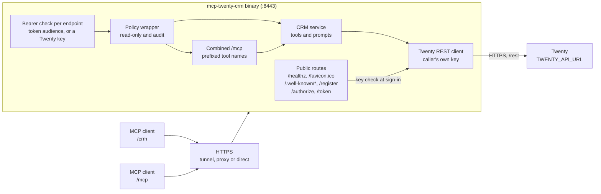
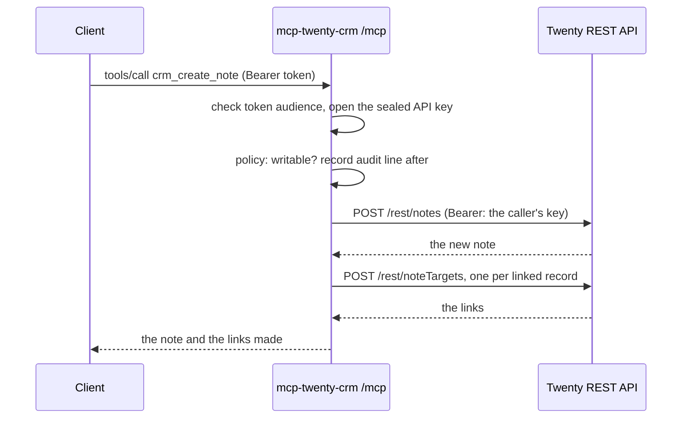

# Architecture

## Request flow

## Crates

| Crate | Role |
|---|---|
| `mcp-server-core` | Configuration reading, the OAuth authorization server, sign-in with a service credential, bearer guards, TLS, logging, metrics, the read-only and audit wrapper, the combined endpoint, and the `Service` trait every service implements. A crates.io dependency, shared with mcp-icloud |
| `mcp-twenty-crm-records` | The `crm` service: the Twenty REST client (`api.rs`), the API key check (`verifier.rs`), the tools (`tools/`), output shaping (`view.rs`) and prompts (`prompts.rs`) |
| `mcp-twenty-crm` | The binary: selects services, mounts each at `/<name>` and the combined `/mcp`, sets people to sign in with their own Twenty key, and runs the server |

## A tool call, end to end

## Design choices

- **No database and no stored keys.** Twenty is the only store. Each person's API key travels sealed inside their own tokens, so restarts and replicas sign nobody out.
- **Every call as the person.** Requests go to Twenty with the caller's own key, so Twenty's roles and permissions decide what each person can do. The server adds nothing on top except the optional read-only switch.
- **Generic first.** The record tools work on any object, including custom ones, by its plural API name. The `create_` tools for people, companies, opportunities, notes and tasks only build Twenty's composite fields from plain arguments.
- **Safe deletes and retries.** `delete_record` soft-deletes unless told otherwise, and writes are never retried, so a slow create cannot run twice.
