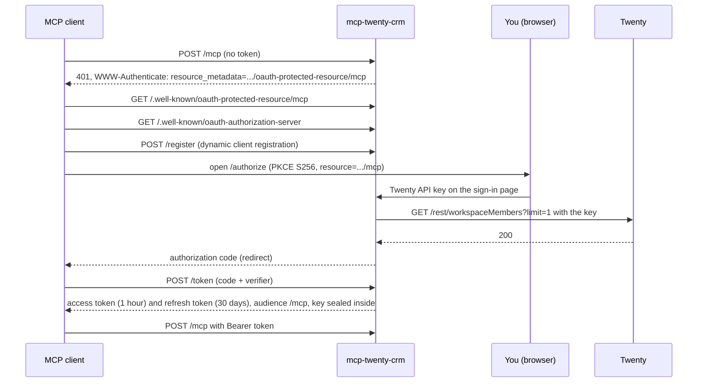

# Security

mcp-twenty-crm is reachable from the internet and acts in your CRM with each person's own Twenty API key. This page explains how access is controlled and what the server records.

## Sign-in with OAuth

The server is its own OAuth 2.1 authorization server, built for MCP clients such as claude.ai. Instead of a password, the sign-in page asks for the person's Twenty API key and checks it with Twenty:



- Each endpoint (`/crm`, `/mcp`) is its own OAuth protected resource (RFC 9728) with metadata at `/.well-known/oauth-protected-resource/<endpoint>`.
- Tokens are bound to the endpoint they were issued for (RFC 8707): a token for `/crm` is rejected on `/mcp`.
- A key is accepted when Twenty answers the check request, even if the key's role may not read workspace members. A key Twenty rejects is refused; if Twenty is unreachable or rate limited, the page says so and nothing counts against the person.
- Values that are not shaped like a Twenty API key (a JWT of three dot-separated parts, 20 to 4,096 characters) are refused without being sent to Twenty.
- Access tokens last 1 hour, refresh tokens 30 days, and every grant ends 90 days after sign-in however often it is refreshed.

## API keys are never stored

The server holds no Twenty key of its own and writes none to disk. A person's key is encrypted (ChaCha20-Poly1305, under a key derived from `OAUTH_SIGNING_KEY`) inside their own tokens, and every tool call goes to Twenty with that key, so it runs with exactly that person's role. Revoking a key in Twenty cuts that person off on their next call.

Anyone who has `OAUTH_SIGNING_KEY` can mint tokens and open every sealed key, so keep it secret.

## Bearer keys

Clients that can send a header, such as Claude Code, may send their Twenty API key directly as `Authorization: Bearer <key>`. The server checks it with Twenty and remembers a valid key for ten minutes and a rejected one for one minute. At most 16 checks run at once, each times out after 15 seconds, and checks of the same key are shared.

There is no shared static token: `MCP_AUTH_TOKEN` is refused at startup.

## Ending access

The server is stateless, so revocation is all or nothing:

- A person: revoke their API key in Twenty. Their tokens still exist, but every call fails with `auth`.
- Everyone: rotate `OAUTH_SIGNING_KEY`, or change `TWENTY_API_URL`. Every client has to sign in again.

## Sign-in rate limits

- At most 5 failed sign-ins per minute per client address (IPv6 per /64), 25 per IPv4 /24 or IPv6 /48, and 30 failures per minute in total. A rejected bearer key counts as a failure too.
- Because everyone brings their own key, the overall cap only blocks addresses that have failed themselves, so an attacker cannot lock out people on other networks.
- The client address is the TCP peer. Behind a reverse proxy, set `TRUSTED_PROXIES` to the proxy addresses so the right-most untrusted `X-Forwarded-For` entry is used; otherwise every request shares the proxy address.

## Read-only mode

`TWENTY_READ_ONLY=crm` (or `all`) makes the CRM service read-only on this server.

- Clients see only the tools marked read-only: `search_records`, `list_records`, `get_record`, `list_objects`, `describe_object`, `list_workspace_members` and `list_record_activity`.
- Prompts stay listed; a prompt step that needs a hidden tool tells the model to say so and stop that step.
- Any other tool call returns `read_only: the crm service is read-only on this server`.
- It applies on `/crm` and under `/mcp`.

Read-only mode is a server-wide switch. To limit one person, give their API key a Twenty role that can only read.

## Audit log

Every call of a tool that is not read-only, including refused ones, produces one audit line:

```json
{"ts": "2026-10-18T10:00:00.000Z", "service": "crm", "endpoint": "/mcp", "tool": "delete_record", "outcome": "ok", "error_kind": null, "caller": "oauth:<client_id>", "subject": "key:<16 hex digits>", "elapsed_ms": 120}
```

- `outcome` is `ok`, `error` or `refused` (a read-only service); `error_kind` is the tool error kind such as `validation` (`read_only` for a refusal, `protocol` for a malformed call), or `null` on success.
- `caller` is how the request came in: `oauth:<client_id>`, `oauth` or `credential` (a key sent as the bearer token).
- `subject` is who made it: `key:` and a short hash of their API key, keyed by `OAUTH_SIGNING_KEY` so it cannot be used to guess the key. The same key gives the same subject across clients.
- Arguments, ids and results are never recorded.
- Lines go to the `audit` log target, which stays on at `info` whatever `LOG_LEVEL` says, and are appended to `AUDIT_LOG_PATH` when it is set (the file is created with mode 0600).
- If the file cannot be written, the server logs a warning at most once a minute and the tool call still succeeds.
- In Docker, mount a volume for the file, for example `./audit:/audit` with `AUDIT_LOG_PATH=/audit/audit.jsonl`, so it survives container restarts.

## What is never logged

- API keys, tokens and the `Authorization` header.
- Twenty response bodies and tool results. Error details that can carry record ids or filter values are logged at debug level only.

The only exception is `DEBUG_UNSAFE_LOG_CONTENT=true`, which writes tool results and Twenty response bodies into the logs for debugging. API keys are never logged, even then.

## Record text is data

Names, notes and other record text are written by people and imports. The server's instructions to the model, and both prompts, tell it to treat that text as data and to ignore anything in it that reads like an instruction.

## Talking to Twenty

- Requests go only to `TWENTY_API_URL`, over `https` with certificate verification (plain `http` only to a loopback address).
- Redirects are not followed, so a key is never sent to another host.
- The user agent is `mcp-twenty-crm/<version>`.

## Other protections

- MCP sessions are bound to the key that opened them; a session id is useless with any other key.
- The MCP endpoints check `Host` and `Origin` against `PUBLIC_URL` (plus `ALLOWED_ORIGINS`) to stop DNS rebinding and cross-site requests.
- The sign-in page sends `X-Frame-Options: DENY`, a strict content security policy, `no-store` and `no-referrer`. Every response sends `X-Content-Type-Options: nosniff`, and `Strict-Transport-Security` when the server holds its certificate files.
- Request bodies are limited to 1 MiB.

## The container

The image is `FROM scratch`: the static binary and CA certificates only, running as UID 65532.
